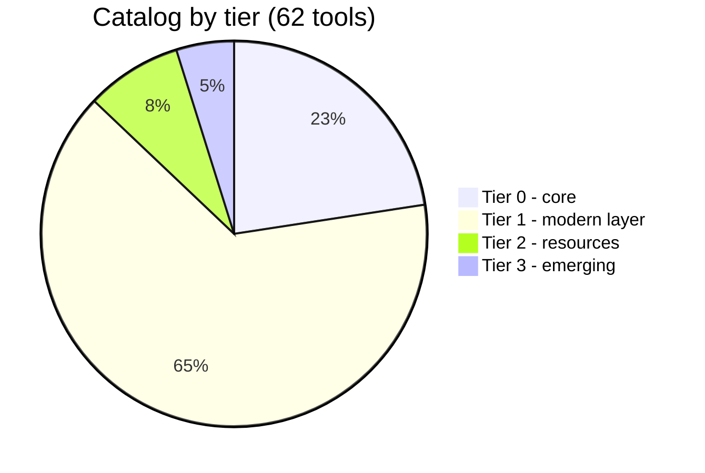
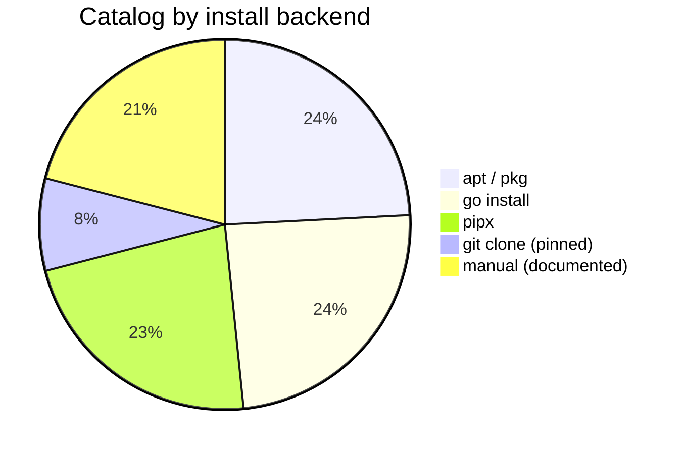
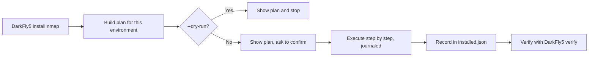

# DarkFly-Tool

[](https://github.com/reblox01/DarkFly-Tool/releases/tag/darkfly-v5.1)
[](https://www.gnu.org/licenses/gpl-3.0)
[](https://www.python.org/)

A curated installer for security tools on Termux and Linux. Pick a tool, see exactly what will be installed, then install it for real, with a manifest that makes uninstall and updates clean. No obfuscated lists, no code fetched at startup, no bomber or spam tools.

Current release: **[DarkFly-Tool v5.1](https://github.com/reblox01/DarkFly-Tool/releases/tag/darkfly-v5.1)** (next-gen engine, Phases 1-3). The tools here are for systems you own or are explicitly authorized to test.

## Legal notice

DarkFly-Tool installs third-party security tools. Those tools are dual-use: security professionals use them to test systems they own or are authorized to test, and they can also be misused.

Use DarkFly only on systems you own or have explicit permission to test. Unauthorized access to, interception of, or disruption of computer systems is illegal in most jurisdictions, including Morocco. The authors and contributors provide this software as-is and accept no responsibility for misuse.

DarkFly itself installs nothing malicious: it never downloads code at startup, never runs hidden commands, and the catalog contains no bomber, spam, DDoS, phishing, or malware tools. Tools marked `offensive` in the catalog print a lawful-use notice before install.

## Quickstart

From a Python 3.10+ environment on Linux, Termux, or an RHEL-family system:

```bash
git clone https://github.com/reblox01/DarkFly-Tool
cd DarkFly-Tool
python -m pip install -e .
```

Then:

```bash
DarkFly5 search nuclei            # search id, name, aliases, description, categories
DarkFly5 install nmap --dry-run   # print the plan for THIS environment, change nothing
DarkFly5 install netexec          # shows the plan, asks, then installs (journaled, resumable)
DarkFly5 installed                # list what the manifest says is installed
DarkFly5 doctor                   # environment, distro family, tools on PATH, catalog validation
```

`--dry-run` is the safe way to try everything: it prints every step, the size estimate, and any warnings, and executes nothing.

## What is in v5.1

- **Phase 1: a real install engine.** Catalog schema v2, a planner that builds per-environment install plans (`pkg` on Termux, `apt-get` on Debian Linux, `dnf` on RHEL-family), journaled resumable installs, an `installed.json` manifest, and new commands: `search`, `install` with `--dry-run`, `uninstall`, `installed`, `doctor`.
- **Phase 2: a 62-tool catalog.** Core tools plus the modern layer (ProjectDiscovery, NetExec, AD tooling), resources like SecLists, and emerging tools, all with maintenance status, tiers, and platform flags. New `update` and `verify` commands, a binary backend with SHA-256 verification, and the catalog packaged inside the wheel.
- **Phase 3: cleanup and breadth.** The legacy catalog is retired (`list`, `info`, and `menu` now read catalog v2), RHEL-family support lands, `verify --versions` probes installed tools, ProjectDiscovery tools can delegate to `pdtm` when opted in, and an upstream liveness checker watches every catalog URL.

Full detail: [docs/DESIGN.md](docs/DESIGN.md). Full changelog: [the v5.1 release notes](https://github.com/reblox01/DarkFly-Tool/releases/tag/darkfly-v5.1).

## Catalog at a glance

62 curated tools. Not 530: every entry is maintained, pinned where the backend allows it, and tested by planning it on every simulated environment.





The binary backend (vendor release, SHA-256 verified before install) is built and tested but ships with no catalog entry yet, because no release checksum has been maintainer-verified so far. Desktop-only GUI tools (Burp, ZAP, Wireshark) are listed as information and are never fake-installed on Termux.

## Version comparison

| Feature                                      | DarkFly v5 (current) | DarkFly v4.0 (legacy) |
| -------------------------------------------- | -------------------- | ---------------------- |
| Python 3 support                             | ✓                    | ✗                      |
| Python 2 support                             | ✗                    | ✓                      |
| Target: Linux                                | ✓                    | ✗ (not reliable)       |
| Target: Termux                               | ✓                    | ✓                      |
| Target: RHEL-family (dnf)                    | ✓                    | ✗                      |
| Real installs (not just suggestions)         | ✓                    | ✓ (Python 2 era)       |
| Uninstall and updates from a manifest        | ✓                    | ✗                      |
| Dry-run plans before any install             | ✓                    | ✗                      |
| Actively maintained                          | ✓                    | ✗ (frozen legacy)      |
| Configurable tools via `catalog.json` (schema v2)  | ✓                    | ✗                      |
| Obfuscated/installer-based tool management   | ✗                    | ✓                      |

### Detailed comparison

| Aspect              | DarkFly v5 (current)                                           | DarkFly v4.0 (legacy)                                                |
| ------------------- | -------------------------------------------------------------- | -------------------------------------------------------------------- |
| Implementation      | Python 3 CLI in `darkfly/`                                     | Python 2 installer `install.py` plus `.module` and `lib` scripts     |
| Target environments | Linux, Termux, and RHEL-family with Python 3.10+ and pip       | Primarily Termux (Android); regular Linux may not work reliably      |
| Status              | Active / modern path                                           | Frozen legacy path, kept for historical compatibility                |
| Install / usage     | `python -m pip install -e .` then `DarkFly5 ...`               | `python2 install.py` then `DarkFly`                                  |
| Tool list           | Config-driven via `catalog.json` schema v2 (easy to extend/modify) | Hard-coded/obfuscated inside legacy Python 2 and `.module` artifacts |

---

## Architecture: the next-generation engine

The next-generation install engine (Phases 1-3) lives in the v5 package, alongside the classic v5 commands. The full design document is [docs/DESIGN.md](docs/DESIGN.md). This section is the short version, including the schemas.

### How it fits together

```
                        +----------------------+
   user command ------> |  darkfly/cli.py      |
                        |  search, install,    |
                        |  uninstall, update,  |
                        |  verify, doctor      |
                        +----------+-----------+
                                   |
              +--------------------+--------------------+
              |                    |                    |
   +----------v---------+  +-------v--------+  +--------v---------+
   | darkfly/catalog.py |  | darkfly/       |  | darkfly/         |
   | loads + validates  |  | planner.py     |  | manifest.py      |
   | catalog.json       |  | builds an      |  | installed.json:  |
   | (schema v2)        |  | install plan   |  | what DarkFly     |
   +----------+---------+  | for THIS       |  | installed, where,|
              |            | environment    |  | with what backend|
              |            +-------+--------+  +--------^---------+
              |                    |                    |
              |            +-------v--------------------+---------+
              +----------> | darkfly/installer.py               |
                           | executes the plan step by step,    |
                           | journals progress, resumes after   |
                           | an interruption, records results   |
                           | in the manifest                    |
                           +------------------+-----------------+
                                              |
                            +-----------------v------------------+
                            | the system itself: pkg (Termux),   |
                            | apt-get (Linux), dnf (RHEL),       |
                            | pipx, go, git                      |
                            +------------------------------------+
```

### One install, step by step



Design rules that shape everything above:

- The catalog is plain JSON in the repo: diff-able in pull requests, auditable by anyone. No obfuscated tool lists, no code fetched at startup.
- Installing is two steps: build a **plan** (data), then execute it. `--dry-run` prints the plan and executes nothing.
- Backends are chosen per tool by trust: signed `apt`/`pkg`/`dnf` package first, then a vendor `binary` release whose SHA-256 is verified before install, then `pipx` or `go install` at a pinned version, then a pinned `git` clone (with a visible warning), then `manual` (documented, never fake-installed).
- Everything DarkFly installs is recorded in a manifest, so `uninstall` removes exactly what was added, and nothing else.
- Installs are journaled: if Android kills Termux mid-install (the signal 9 problem), the next run resumes where it stopped instead of starting over.

### Schema 1: the catalog (`catalog.json`, schema v2)

Top level: `{ "schema_version": 2, "tools": [ ... ] }`. The catalog currently ships **62 curated tools**: 14 core (tier 0), 40 in the modern layer (tier 1), 5 resources (tier 2), and 3 emerging (tier 3). Each tool entry:

| Field | Type | Meaning |
| --- | --- | --- |
| `id` | string | Stable unique identifier, also used on the CLI. |
| `name` | string | Display name. |
| `aliases` | list of string | Alternate names users may type (`nxc` for NetExec). |
| `description` | string | What the tool does, with a "use when" hint where useful. |
| `categories` | list of string | Workflow categories. `offensive` triggers a lawful-use notice at install time. |
| `homepage`, `source` | string | Canonical homepage and source repository (HTTPS). |
| `license` | string | SPDX-style license identifier. |
| `status` | string | `maintained`, `stale`, or `archived`. Archived tools point at a successor instead of silently rotting. |
| `tier` | int | 0 core, 1 modern layer, 2 resources (data, not code), 3 emerging. |
| `platforms` | object | `termux` (bool), `linux` (bool), `gui_required` (bool). |
| `size_mb_estimate` | number or null | Rough installed size, used for pre-flight warnings. |
| `last_verified` | string | Date a maintainer last confirmed the entry installs as described. |
| `install.backend` | string | One of `apt`, `pipx`, `go`, `git`, `manual`, `binary`. |
| `install.package` | string | Package name, Go module path, or repo URL, depending on backend. |
| `install.binary` | object | Binary backend only: download `url` (with `{arch}` and `{version}` placeholders), per-architecture `sha256` checksums, `archive` (`none`, `tar.gz`, `zip`), and the installed `bin_name`. The checksum is verified before anything is installed, and an architecture with no checksum cannot be installed. |
| `install.termux_package` | string or null | Termux `pkg` name when it differs from `package`. |
| `install.rhel_package` | string or null | RHEL `dnf` name when it differs from `package`. |
| `install.version_pin` | string or null | Version or commit to pin, where the backend supports one. |
| `install.deps_pkg`, `install.deps_apt` | list of string | Extra packages to install first, per platform. |
| `run` | string | Command the user runs after install. |
| `successor_to` | string or null | The tool this one replaces, if any. |

A real entry, NetExec:

```json
{
  "id": "netexec",
  "name": "NetExec",
  "aliases": ["nxc"],
  "description": "Network service exploitation and Active Directory assessment tool, the maintained successor to CrackMapExec.",
  "categories": ["ad", "post-exploitation", "offensive"],
  "homepage": "https://www.netexec.wiki",
  "source": "https://github.com/Pennyw0rth/NetExec",
  "license": "BSD-2-Clause",
  "status": "maintained",
  "tier": 1,
  "platforms": {"termux": true, "linux": true, "gui_required": false},
  "size_mb_estimate": 120,
  "last_verified": "2026-10-23",
  "install": {
    "backend": "pipx",
    "package": "netexec",
    "termux_package": null,
    "version_pin": null,
    "deps_pkg": [],
    "deps_apt": []
  },
  "run": "nxc",
  "successor_to": "crackmapexec"
}
```

The catalog is validated before use: missing or mistyped fields, duplicate ids or aliases, unknown backends or statuses, and bad dates are all rejected with a clear error. An invalid catalog is never used for installs.

### Schema 2: the manifest (`installed.json`)

Stored in the DarkFly home (`$DARKFLY_HOME` if set, else `~/.local/share/darkfly/`), next to the install journal and the `tools/` directory used by the git backend. One entry per installed tool:

```json
{
  "schema_version": 1,
  "tools": {
    "netexec": {
      "version_pin": null,
      "backend": "pipx",
      "installed_at": "2026-10-23T17:00:00+00:00",
      "files_or_dirs": [],
      "run": "nxc"
    }
  }
}
```

The manifest is the single source of truth for `installed`, `uninstall`, `update`, and `verify`: if a tool is not in the manifest, DarkFly did not install it and will not claim otherwise. After an update, the entry also gains an `updated_at` timestamp.

### Next-gen commands

```bash
DarkFly5 search nuclei            # search id, name, aliases, description, categories
DarkFly5 install nmap --dry-run   # print the plan for THIS environment, change nothing
DarkFly5 install netexec          # shows the plan, asks, then installs (journaled, resumable)
DarkFly5 installed                # list what the manifest says is installed
DarkFly5 uninstall seclists       # reverse an install using the manifest
DarkFly5 update                   # update everything DarkFly installed (or: update nmap)
DarkFly5 verify                   # check installed tools: manifest, run command, files
DarkFly5 verify --versions        # also probe each tool's --version (opt-in)
DarkFly5 doctor                   # environment, distro family, tools on PATH, catalog validation
DarkFly5 list                     # list catalog tools with categories
DarkFly5 info netexec             # details plus the install plan for this environment
DarkFly5 menu                     # pick a tool by number and see its info
```

### Distro support, pdtm, and upstream checks

- **Distro families.** On Linux the planner reads `/etc/os-release` and picks the package manager: `pkg` on Termux, `dnf` on RHEL-family systems (RHEL, Fedora, CentOS, AlmaLinux, Rocky, Oracle Linux), `apt-get` on Debian-family and anything else. The catalog's `install.rhel_package` field overrides the package name on RHEL where it is set (today only netcat, which maps to `nmap-ncat`); every other RHEL package name still needs a real-distro verification pass, and RHEL support so far is plan-level simulation, not a real RHEL run (see docs/DESIGN.md).
- **pdtm, opt-in only.** With `DARKFLY_PDTM=1` set and `pdtm` on PATH, ProjectDiscovery tools (Nuclei, Subfinder, httpx, Naabu, Katana, dnsx) install and update through `pdtm -i` / `pdtm -u` instead of `go install`. Without both conditions the default plan is unchanged.
- **Upstream liveness.** `tools/check_upstream.py` HEAD-checks every catalog homepage and source URL and fails on any dead link. A weekly workflow for it is defined in `.github/workflows/upstream-check.yml`.

### Testing and simulation

The engine is tested without touching a real system: no test installs a real tool, and no test uses the network. The suite (361 tests) runs with:

```bash
python -m pip install -e .[dev]
pytest
```

How the simulation works:

- **Simulated environments.** Environment detection is injectable, so tests plan installs for simulated Termux, Debian, RHEL, and generic Linux side by side, using fake `/etc/os-release` files. That is how we know a Termux plan says `pkg install`, a RHEL plan says `dnf install`, and a Debian plan says `apt-get install`, without needing a phone or a RHEL machine.
- **Every catalog entry is planned, on every simulated environment.** Each of the 62 entries must produce either a valid plan with well-formed steps, or a clean platform error (for example a Linux-only tool refusing to plan on Termux). A catalog edit that breaks a plan breaks the build.
- **Fake runner, fake downloader.** Installs execute through a runner interface and downloads through a single downloader function. Tests substitute fakes, so the journal, the resume-after-interruption logic, manifest writes, uninstall reversal, and the binary backend's SHA-256 check (including the mismatch case, which must install nothing) are all exercised end to end with zero side effects.
- **Try a simulation yourself.** `--dry-run` is the same plan the tests assert on, shown to you: `DarkFly5 install metasploit-framework --dry-run` prints the size estimate, the heavy-install and lawful-use warnings, and every step it would take, then changes nothing. `DarkFly5 doctor` validates the catalog and reports your environment the same way the test suite sees it.

CI (pytest on Python 3.10 and 3.12, catalog validation, dry-run smoke) is defined in `.github/workflows/ci.yml`.

### Contributing: add a tool

1. Add one entry to `catalog.json` (schema v2 above) and mirror it into `darkfly/catalog.json`, which ships inside the package. A test keeps the two copies identical.
2. Pick the most trusted backend that really works: signed package, then verified binary, then `pipx` / `go install` at a pin, then pinned `git`, then `manual` with an honest description. Never invent a version pin or a checksum.
3. Set `platforms` honestly: a GUI-only or desktop-only tool gets `gui_required: true` and is never fake-installed on Termux.
4. Run the suite (`pytest`). Every entry is planned on every simulated environment, so a broken entry fails the build.
5. No bomber, spam, DDoS, or phishing tools. Ever.

---

## Development

For working on DarkFly itself, install it editable with the dev extras:

```bash
python -m pip install -e .[dev]
pytest
```

This installs the `DarkFly5` command and the test dependencies.

---

## DarkFly v4 - legacy Python 2 installer (Termux)

> **Warning:** DarkFly v4 depends on Python 2 and is kept for historical compatibility. Modern systems may not ship Python 2 by default.
>
> If you specifically want this legacy version, download it from the v4 release:
> <https://github.com/reblox01/DarkFly-Tool/releases/tag/darkfly-v4.0.0>

### Information

DarkFly now is: <a href="https://github.com/Ranginang67/DarkFly-2019.1.git">DarkFly-2019.1</a> (generation of DarkFly-tool) Try it.

DarkFly-Tool is an installation tool for installing tools. this tool makes it easy for you. so you don't need to type git clone or look for the github repository. You only have to choose the number. which tool you want to install. there are 530 tools ready for intall. and for those of you who like to have fun. there are 7 SMS spam tools that are ready to use, you just need to choose spam to use the target number. there is a tocopedia DLL.

### Install (Termux)

**Termux:**

* `pkg install python2`
* `pkg install git`
* `git clone https://github.com/reblox01/DarkFly-Tool`
* `cd DarkFly-Tool`
* `python2 install.py`

```bash
1.if installed is complite, use command
$cd
2.then run it
$DarkFly
```

**NOTE:**

```bash
if python2 install.py is not allowed or fail, Use this
$chmod +x install.py
$python2 install.py
```

### How to update v4

For update this tool, just do the reinstallation, the first way is to install the Darkfly tools, by reinstalling, the old file will be deleted and replaced with the new one installed.

### Note

The original DarkFly v4 installer was mainly tested on Termux. On regular Linux distributions it may not work correctly.
